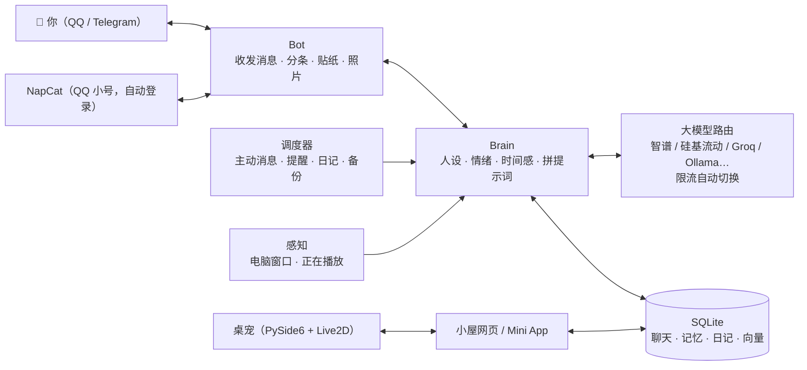

<div align="center">

# ai-life

**一个跑在你自己电脑上、在 QQ / Telegram 里陪你的 AI 伴侣**

有记忆、有情绪、有自己的生活，会主动找你，会发照片和表情包，还有桌宠和手机小屋。Windows 上一行命令部署，QQ 自动装好 NapCat。

[](https://www.python.org/)
[](https://github.com/NapNeko/NapCatQQ)
[](https://core.telegram.org/bots)
[](#部署)
[](LICENSE)

[功能](#功能) · [部署](#部署) · [配置](#配置详解) · [日常使用](#日常使用) · [常见问题](#常见问题) · [功能详解](docs/FEATURES.md) · [写人设](PERSONA.md)

</div>

---

## 简介

ai-life 不是一个“问一句答一句”的聊天机器人。TA 有自己的一天：要上课或上班，晚上写日记，身边有固定的朋友，也有持续几周的经历和几个月的长期目标。TA 记得你说过的事，会在合适的时候主动找你，你很久不回会想你，你难过时会认真陪你。

- **完全本地运行**：程序和全部数据都在你自己的电脑上，只有发给大模型的那部分内容会经过对应的服务商。
- **零成本可用**：默认配置只用免费的大模型接口（智谱、硅基流动等），不需要显卡，也不需要服务器。
- **角色完全由你决定**：自带几个人设，也可以回答几个问题自动生成、导入 SillyTavern 角色卡，或者用 Markdown 自己写。

## 功能

| | 功能 | 说明 |
| --- | --- | --- |
| 💬 | **像真人一样聊天** | 分几条发、有打字停顿、会引用你的话、发贴纸，偶尔打错字再改；你连发几条时等你说完再一起回 |
| 🧠 | **长期记忆** | 自动整理关于你的事，新信息更新旧信息、不重复记；关键词 + 语义向量混合检索；TA 自己说过的设定也会记住，前后一致 |
| 💗 | **情绪与时间感** | 心情会随聊天变化并慢慢平复；知道你几天没来、现在是深夜还是早上；好感度永远是满的 |
| 🌏 | **TA 自己的生活** | 每天的安排、每晚的日记、身边的人、持续几周的故事线、长期目标；按真实日期过学期、考试周、寒暑假或工作日 |
| 🔔 | **主动找你** | 早安晚安、想你了来找你、到点提醒你；会学习你的回复习惯，少打扰你；夜里免打扰 |
| 🌙 | **关机前后** | 关掉程序时 TA 说一声“先去忙了”；开机后说说这段时间在干嘛，错过的提醒和纪念日一起补上 |
| 🖥️ | **知道你在干嘛**（可关） | 电脑上在玩哪个游戏、在 B 站看什么、今天各忙了多久，会顺着聊，提醒你歇会儿 |
| 🏠 | **小屋** | Telegram 里点“小屋”打开，看 TA 的心情、日记、记忆、留言板，还能直接改人设；电脑浏览器也能看 |
| 🧸 | **桌宠** | Live2D 小人待在桌面上（默认是金发、戴贝雷帽的小魔法师 Rice，Live2D 官方免费示例模型），透明背景、不占任务栏，可以打字聊天，话冒在头顶气泡里、会做动作；也能换成自己的模型 |
| 🎧 | **一起做的事** | 打卡、追番、听歌、愿望清单、时间胶囊、每月纪念册、睡前故事、小游戏 |
| 🔗 | **看得懂你发的东西** | 图片、动图、视频、文件、位置，B 站 / YouTube / 公众号 / 网页链接（先点开读完再回你） |
| 🐧 | **QQ** | 一键自动下载配置 NapCat，扫一次码以后自动登录；私聊和 Telegram 共用记忆、你在哪边说话就在哪边回，也可以只用 QQ |
| 👥 | **群聊角色**（另一个仓库） | 想要一个待在 QQ 群里的角色：用 **[ai-life-group](https://github.com/star031104/ai-life-group)**（另一个小号、另一个人设，一键部署，可以和这里同时开） |

每个功能的详细说明见 **[docs/FEATURES.md](docs/FEATURES.md)**。

## 工作原理



---

## 部署

### 一键部署（Windows，推荐）

**最快的方式**：在开始菜单搜 “PowerShell”，打开后粘贴这一行回车：

```powershell
irm https://raw.githubusercontent.com/star031104/ai-life/main/get.ps1 | iex
```

它会把代码下载到 `文档\ai-life`（GitHub 慢时自动换加速地址），然后打开 `install.bat`，剩下的全自动：

| 步骤 | 自动做了什么 | 你要做的 |
| --- | --- | --- |
| Python | 有 conda 的 `ailife` 环境就用它；否则在项目里建 `.venv`；电脑上连 Python 都没有就用 `winget` 装 Python 3.11 | 无 |
| 依赖 | 清华镜像装依赖，失败自动换默认源；顺带装农历、正在播放的歌、透明桌宠（PySide6） | 无 |
| ffmpeg | 用 `winget` 装（看你发的动图、视频要用） | 无 |
| 配置向导 | 问你在哪聊（QQ / Telegram / 都要）、大模型 Key、城市、人设 | 回答几个问题 |
| NapCat（选了 QQ 时） | 自动下载官方 NapCat（Node 版，**自带 QQ 内核，不用另外装 QQ**）、配好 WebSocket 和 token、启动它 | 用 TA 的 **QQ 小号**扫一次码 |
| 自动登录 | 登录成功后把小号写进 NapCat 的自动登录；以后 `start.bat` 会顺便带 `-q 号码` 启动 NapCat | 无（**以后不用再扫码**） |
| 选你自己 | 列出小号的好友，你选出自己的 QQ，写好 `config.yaml` | 选一个编号 |

装完双击 **`start.bat`** 就行。

> 不想用 PowerShell：点本页右上角绿色的 **Code → Download ZIP**，解压（路径里最好别有中文和空格，比如 `C:\ai-life`），双击 **`install.bat`**，效果一样。
>
> 已经装过、只想加 QQ：双击 **`qq_setup.bat`**（没有 NapCat 会自动下载；已经有的直接用）。

### 你需要准备

| 项目 | 说明 | 必需 |
| --- | --- | --- |
| 一台电脑 | Windows 10/11（推荐，一键部署和桌宠只支持 Windows）或 Linux / macOS。不需要独立显卡，内存 8 GB 以上 | ✅ |
| 大模型 API Key | [智谱开放平台](https://open.bigmodel.cn) 和 / 或 [硅基流动](https://cloud.siliconflow.cn)，都有免费模型。有一个就能用，两个都有更稳 | ✅ |
| 聊天的地方（二选一或都要） | **QQ**：给 TA 准备一个 QQ **小号**（非官方协议有封号风险，别用主号）；**Telegram**：在 [@BotFather](https://t.me/BotFather) 建一个 bot | ✅ |
| 代理 | 只有用 Telegram 时需要（中国大陆），例如 Clash 的 `http://127.0.0.1:7890` | 视情况 |

> 程序跑在电脑上，电脑关机或睡眠时 TA 不在线。想让 TA 一直在，见 [让 TA 一直在线](#让-ta-一直在线)。

### 申请大模型 API Key

| 平台 | 获取方式 | 用途 |
| --- | --- | --- |
| **智谱** | 注册 [open.bigmodel.cn](https://open.bigmodel.cn) → 右上角“API Keys” → 新建 | 主力聊天（GLM Flash 系列免费）、看图 |
| **硅基流动** | 注册 [cloud.siliconflow.cn](https://cloud.siliconflow.cn) → “API 密钥” → 新建 | 兜底聊天、记忆向量检索 |
| Groq（可选） | [console.groq.com](https://console.groq.com) → API Keys（需要代理） | 极快的兜底 |
| 魔搭（可选） | [modelscope.cn](https://modelscope.cn) → 访问令牌（需绑定阿里云账号） | 每晚整理记忆、写日记 |

> 各平台的免费额度和模型以官网为准。任何 OpenAI 兼容接口（DeepSeek、通义、Kimi、本地 Ollama……）都可以加进去，见 [大模型配置](#大模型配置)。

### 用 Telegram 的话：创建 Bot

1. 在 Telegram 里搜索 **@BotFather**，发送 `/newbot`。
2. 按提示输入显示名称（比如“林汐”）和用户名（必须以 `bot` 结尾，比如 `linxi_home_bot`）。
3. BotFather 会回复一串形如 `123456789:AAH...` 的 **token**，配置向导里粘贴进去，**不要发给别人**。
4. 启动后在 Telegram 里给 bot 发 **`/start`**：**第一个发 `/start` 的人会成为唯一的主人**。

### 其他安装方式

<details>
<summary><b>Linux / macOS</b></summary>

```bash
git clone https://github.com/star031104/ai-life.git && cd ai-life
# 需要 Python 3.10+ 和 ffmpeg
sudo apt install python3-venv ffmpeg     # Ubuntu / Debian
# brew install python ffmpeg             # macOS

bash install.sh      # 创建 .venv、安装依赖；没有配置时自动打开配置向导
```

桌宠和 NapCat 一键安装只支持 Windows；QQ 在 Linux 上请用 NapCat 的 Docker 版（见 [docs/QQ.md](docs/QQ.md)），装好后 `python run.py qqsetup --manual`。服务器上长期运行可以用 `tmux` / `screen`，或者写一个 systemd 服务执行 `bash start.sh`。

</details>

<details>
<summary><b>手动安装（任何系统）</b></summary>

```bash
python -m venv .venv
# Windows: .venv\Scripts\activate    Linux / macOS: source .venv/bin/activate
pip install -r requirements.txt
pip install lunar_python PySide6          # 可选：农历、透明桌宠
python run.py setup                       # 配置向导；或者把 config.example.yaml 复制成 config.yaml 自己填
```

</details>

### 配置向导生成的文件

向导随时可以重跑：`setup.bat` 或 `python run.py setup`。

| 文件 / 文件夹 | 内容 | 能否分享 |
| --- | --- | --- |
| `config.yaml` | 所有设置 | 可以（密钥已被替换成 `${名字}` 引用） |
| `.env` | 所有密钥（大模型 Key、bot token、NapCat 的 token） | **不能**，不要发给任何人 |
| `napcat/` | 自动下载的 NapCat 和小号的登录信息 | **不能** |
| `data/` | 聊天、记忆、日记、照片 | **不能** |

### 自检并启动

1. 双击 **`selftest.bat`**（或 `python run.py selftest`）：离线跑一遍核心流程，不联网、不碰你的数据。全是 ✅ 就可以继续。
2. 双击 **`start.bat`**（Linux / macOS：`bash start.sh`）启动。**不会开黑窗口**：她和 NapCat 都在后台跑，任务栏右下角多一个粉色的小图标（可能藏在 ^ 里）。
   右键图标：看状态、打开小屋、看日志、换大模型、重启、开机自动启动、退出；双击图标打开小屋。用了 QQ 的话，NapCat 会顺便在后台启动（自动登录）。
   程序意外退出时 10 秒后自动重启。第一次运行会自动装上托盘需要的两个小包（pystray、Pillow）。想看实时输出排查问题就用 `start_console.bat`（老样子，开一个窗口）。
3. 用你的 QQ 给 TA 的小号发句话（记得先**加好友**，不然 TA 没法主动找你），或者在 Telegram 里给 bot 发 `/start`。
4. 遇到问题先发 **`/diag`**：它会检查每个大模型接口、代理、QQ、数据库，告诉你哪里没配好。

### 可选：桌宠、小屋、开机自启

- **桌宠**：Windows 上启动时自动出现在桌面右下角。背景不透明的话，双击 `pet_setup.bat` 安装 PySide6 后重启。默认形象是 Live2D 官方免费示例模型 Rice（金发、贝雷帽的小魔法师），`pet.preset: haru` 可以换回原来的 Haru。想换成自己的 Live2D 模型，把模型文件夹放进 `data/pet/model/` 就会自动识别（请使用你有权使用的模型）。
- **小屋**：手机上在 Telegram bot 聊天框左边点“小屋”按钮，QQ 里给 TA 发 `/小屋`；电脑上浏览器打开 `http://127.0.0.1:8765`。手机小屋通过免费的 Cloudflare 临时隧道访问，程序会自动下载 `cloudflared`。
- **开机自启**：双击 `autostart_on.bat`，或者发 `/autostart 开`。关闭用 `autostart_off.bat`。
- **QQ 群**：ai-life 只管私聊。群里的角色是单独的程序 **[ai-life-group](https://github.com/star031104/ai-life-group)**：另一个 QQ 小号、另一个人设，一行命令部署，它会从这里的 NapCat 克隆一份给自己用，两边可以同时开。
- **QQ 的更多说明**：见 [docs/QQ.md](docs/QQ.md)。

### 让 TA 一直在线

- 在 Windows“电源和睡眠”里，把**插电时的睡眠**改成“从不”，合上盖子时选“不采取任何操作”。程序运行时也会阻止系统自动睡眠（`keep_awake: true`）。
- 打开开机自启。
- 关机前右键托盘图标 →“退出”，TA 会跟你说一声再下线（直接关机也会说）。

### 更新

再跑一次一键部署那行 PowerShell 就行：它只覆盖代码，不动 `config.yaml`、`.env`、`data/`、`napcat/`。用 git 的话：

```bash
git pull
install.bat               # 或 pip install -r requirements.txt
python run.py selftest    # 全是 ✅ 再重启 start.bat
```

### 备份与换电脑

```bash
python run.py export            # 打包记忆、设置、密钥、照片，运行中也能打
python run.py import 包.zip     # 在新电脑装好程序后导入
```

另外，每天会自动备份数据库到 `data/backup/`（保留 7 天），装了 OneDrive 的话再复制一份过去（`backup.extra_dir` 可改）。**两台电脑不要同时运行同一个 bot**，否则会互相抢消息。

---

## 配置详解

所有设置都在 `config.yaml` 里，每一项都有中文注释。改完重启生效。常用部分：

| 配置段 | 作用 |
| --- | --- |
| `proxy` | 访问 Telegram 的代理，支持 `http://` 和 `socks5://` |
| `persona_file` | 当前使用的人设文件 |
| `keys` | 各平台的 API Key（首次启动后会挪进 `.env`） |
| `llm.profiles` / `llm.routes` | 大模型接口，以及每种用途按顺序用哪些 |
| `telegram` | bot token、主人 ID、贴纸包 |
| `style` | 打字速度、表情包频率、错字率 |
| `proactive` | 主动消息：频率、免打扰时段、早安晚安时间、连续未回复上限 |
| `away` | 关机前道别、开机后补上错过的事 |
| `qq` | QQ 私聊：NapCat 地址、你的 QQ、NapCat 文件夹和自动启动（`qq_setup` 会写好） |
| `sense` | 电脑感知：只看程序名，还是连视频标题、文档名一起看 |
| `web` / `miniapp` | 小屋网页、手机 Mini App |
| `pet` | 桌宠：大小、位置、模型、是否主动搭话 |
| `story` / `mind` / `her_world` | TA 的故事线、内心独白、身边的人和长期目标 |
| `backup` / `letter` / `links` | 备份、每周来信、读链接 |

### 人设

角色就是 `persona/` 里的一个 Markdown 文件：开头几行写名字、称呼、性别、年龄、身份、外貌，下面用自然语言写 TA 是谁、性格、说话方式，最后几段对话示例。

```bash
python run.py persona new                   # 回答几个问题生成（可以让大模型帮忙扩写）
python run.py persona import 角色卡.png      # 导入 SillyTavern / TavernAI 角色卡（.png / .json）
python run.py persona use persona/xxx.md    # 切换角色（每个角色有自己的记忆）
python run.py persona check persona/xxx.md  # 检查写法
```

自带：`linxi.md`（林汐，温柔的插画编辑）、`shenyan.md`（沈言，男友向）、`template.md`（带注释的模板）。完整写法见 **[PERSONA.md](PERSONA.md)**。

### 大模型配置

**最省事：用自己的接口不用写配置。** 双击 **`llm.bat`**，或者在电脑上打开小屋（`http://127.0.0.1:8765`）→ 设置 →“大模型”：
填接口地址（DeepSeek、通义、Kimi、OpenRouter、本机 Ollama / LM Studio 都列好了，也可以粘贴任何 OpenAI 兼容的地址）和 Key →
自动测连通、列出这个接口的模型 → 选一个 → 试聊一句看速度 → 选它当主力、当备用，还是只干后台的活（整理记忆、写日记）。
推理模型回复是空的时候会自动试着关掉“思考”。加的接口写在 `config.llm.yaml`（Key 在 `.env`），不动你的 `config.yaml`；
小屋里加完点“重启生效”就能用上。配置向导里也可以顺便加一个。

手动写：`llm.profiles` 里是各个接口，`llm.routes` 是每种用途按顺序用哪些：

```yaml
llm:
  profiles:
    my_deepseek:                       # 名字随便起
      base_url: https://api.deepseek.com/v1
      key: deepseek                    # 对应 keys 里的名字
      model: deepseek-chat
  routes:
    chat:   [glm_flash, my_deepseek, sf_qwen3_8b]   # 聊天、主动消息
    helper: [sf_glm4_9b, glm_flash]                 # 整理记忆、写日记等后台任务
    vision: [zhipu_vision]                          # 看图
```

- 一个接口限流或出错会自动换下一个；全部失败时 TA 会先说一句“网卡了，等我一下”，然后自动重试。
- 聊天优先：后台整理记忆这类任务会等你聊完再做，免得抢免费额度。
- 想用本地模型：装 [Ollama](https://ollama.com)，取消 `config.example.yaml` 里 `local_qwen` 的注释，加进 routes 当最后的兜底。
- 换完模型跑 `python run.py bench` 测速度，跑 `python run.py eval` 看人设表现有没有变差。

---

## 日常使用

### 聊天里的命令（Telegram / QQ 都能用）

| 命令 | 作用 |
| --- | --- |
| `/status` | TA 现在的心情和今天的安排 |
| `/memory` · `/forget 编号` | TA 记得的关于你的事 / 删掉一条 |
| `/diary` · `/letter` · `/recap` | 日记 / 每周来信 / 每月纪念册 |
| `/story` · `/goals` · `/people` · `/mind` | 最近经历的事 / 长期目标 / 身边的人 / 在想什么 |
| `/photo` | 让 TA 发张照片 |
| `/city` · `/schedule` | 告诉 TA 你在哪个城市 / 你的作息 |
| `/dates` · `/shows` · `/watched` · `/song` | 重要日子 / 一起追番 / 看完一集 / 推荐一首歌 |
| `/habit` · `/wish` · `/capsule` | 一起打卡 / 愿望清单 / 时间胶囊 |
| `/game` | 小游戏 |
| `/home` · `/note` | 打开小屋 / 在留言板留言 |
| `/persona` | 查看 / 切换角色，改完人设后 `/persona reload` |
| `/quality` | 这一周 TA 的表现（重复、出戏、回复长度……） |
| `/diag` | 一键自检 |
| `/sense` · `/autostart` | 感知设置 / 开机自启 |

### 命令行

| 命令 | 作用 |
| --- | --- |
| `python run.py` | 启动 |
| `python run.py setup` | 配置向导 |
| `python run.py llm` | 自定义大模型：填地址和 Key → 测连通 → 选模型 → 试聊 → 加进路由（`llm.bat`） |
| `python run.py qqsetup` | QQ 一键配置（没有 NapCat 就自动下载；`--manual` 只读现成配置） |
| `python run.py persona …` | 人设管理（list / check / use / new / import） |
| `python run.py selftest` | 离线自检 |
| `python run.py console` | 不连 Telegram，在命令行里和 TA 聊（调人设用） |
| `python run.py eval [--quick] [--judge]` | 人设评测：重复率、出戏、长对话、记忆 |
| `python run.py bench` | 测每个大模型接口的速度 |
| `python run.py pet` | 重新打开桌宠 |
| `python run.py export` / `import 包.zip` | 备份 / 换电脑 |

---

## 常见问题

<details>
<summary><b>TA 不回消息</b></summary>

在 Telegram 里发 `/diag`，或者看 `data/logs/ailife.log`。最常见的原因：代理没开、API Key 填错、免费模型限流（会自动换备用接口，可以多配一个平台的 Key）。

</details>

<details>
<summary><b>日志里报 Conflict</b></summary>

同一个 bot 同时在两个地方运行了。同一台电脑上托盘只会开一个；换过电脑的话，旧电脑上别再启动。

</details>

<details>
<summary><b>pip 安装失败</b></summary>

先确认网络正常，再运行一次 `install.bat`（清华镜像失败时会自动换默认源）。

</details>

<details>
<summary><b>每次启动 NapCat 都要扫码</b></summary>

旧版本的启动参数写错了（NapCat 只认 `-q 号码`），更新到最新代码就好。确认 `config.yaml` 的 `qq:` 里有 `napcat_qq: 她的小号`（`qq_setup.bat` 会写）。如果小号在手机上被踢下线、改了密码，或者很久没登录，QQ 会要求重新扫码，这时二维码会自动弹出来，扫一次就行。

</details>

<details>
<summary><b>NapCat 下载失败</b></summary>

会依次试 GitHub 直连和几个公共加速地址。都不行的话，手动打开 [NapCat 发布页](https://github.com/NapNeko/NapCatQQ/releases) 下载 `NapCat.Shell.Windows.Node.zip`，放进项目文件夹，再双击 `qq_setup.bat`（会直接用这个 zip）。

</details>

<details>
<summary><b>手机小屋打不开</b></summary>

小屋用 Cloudflare 免费临时隧道，每次启动地址会变，程序会自动更新按钮。刚启动或电脑刚从睡眠醒来时等一分钟再点。在电脑浏览器里直接打开隧道地址会提示“请从 Telegram 里打开”，这是正常的：电脑上请用 `http://127.0.0.1:8765`。

</details>

<details>
<summary><b>想换角色但不想丢记忆</b></summary>

每个角色的记忆分开保存，换回来都还在。想让新角色继承现在的记忆：`python run.py persona use 文件 --share`。

</details>

<details>
<summary><b>桌宠有白色方框 / 占了任务栏</b></summary>

双击 `pet_setup.bat` 安装 PySide6，然后重启 start.bat。

</details>

---

## 隐私与安全

- 数据都在你自己的设备上：`data/`（聊天、记忆、照片）、`config.yaml`（设置）、`.env`（密钥），三者都在 `.gitignore` 里，不会被提交。
- 日志里如果出现密钥，会自动打码。
- 小屋网页默认只监听本机；手机 Mini App 的每个请求都校验 Telegram 签名，只有主人能看。
- 读链接时只访问公网地址，不会被一个链接引去访问你的路由器或局域网设备。
- 只有主人能和 TA 对话，其他人发消息会被忽略。

## 内容准则

角色都是成年人，内容保持健康：不写露骨内容，不用冷战、威胁或让人愧疚的方式绑住你。你说起伤害自己的念头时，TA 会认真对待，并鼓励你找身边的人或专业帮助。AI 伴侣不能代替现实中的人际关系和专业支持。

## 项目结构

```
ai-life/
├── run.py                 入口：启动、配置向导、人设管理、自检、评测、备份
├── config.example.yaml    配置模板（复制成 config.yaml）
├── persona/               人设（template.md 是带注释的模板）
├── ailife/                程序本体
│   ├── bot*.py            Telegram 收发、命令、媒体
│   ├── brain.py           拼提示词、时间感、生成回复
│   ├── memory.py          记忆整理、日记、日程、每周来信
│   ├── retrieval.py       关键词 + 向量混合检索
│   ├── emotion.py         情绪数值与衰减
│   ├── proactive*.py      主动消息、提醒、纪念日
│   ├── away.py            关机前道别、开机后补上错过的事
│   ├── story.py · herworld.py · mind.py   TA 的故事线、身边的人、内心独白
│   ├── sense.py           电脑感知
│   ├── web*.py · tunnel.py                 小屋网页、Mini App 隧道
│   ├── pet.py             桌宠窗口
│   ├── qq*.py · napcat_*.py                 QQ（NapCat）收发、一键安装、自动登录
│   └── fftool.py          ffmpeg（动图 / 视频截帧）
├── docs/
│   ├── FEATURES.md        各功能详细说明
│   └── TESTING.md         实机测试清单
├── tests/                 自动测试（python -m pytest tests）
├── get.ps1                一行命令部署（下载代码 + 运行 install.bat）
├── tools/tray.pyw         托盘图标（start.bat 用它在后台运行，不开窗口）
├── install.bat · start.bat · start_console.bat · selftest.bat · setup.bat · qq_setup.bat · llm.bat · pet_setup.bat   Windows 脚本
├── tools/env.bat          Windows 脚本共用：找到 .venv 或 conda 环境
└── install.sh · start.sh  Linux / macOS 脚本
```

## 参与开发

```bash
pip install -r requirements.txt pytest pytest-asyncio
python -m pytest tests -q        # 不联网，用假的大模型和假的 Telegram
```

欢迎提 Issue 和 Pull Request。报告问题时请附上 `/diag` 的结果和相关日志片段（记得删掉私人内容）。

## 许可

[MIT](LICENSE)
