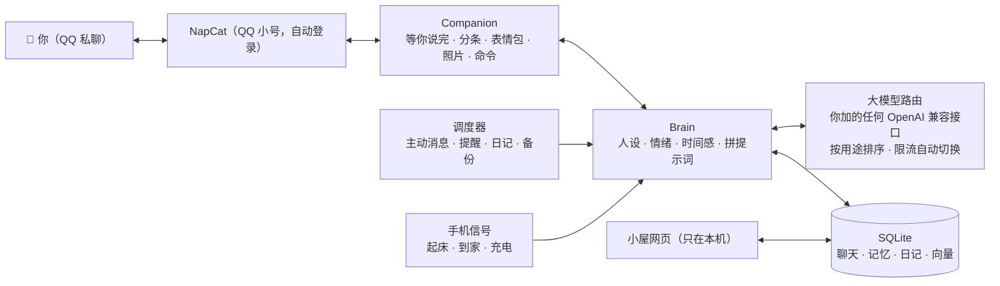

> 这是 ai-life 仓库里“有希（QQ 私聊）”这个角色的说明（12.0 起三个合在一个仓库）。总的怎么装、怎么启动看 [根目录 README](../README.md)；她的家在 `home/yuki/`（老安装还在仓库根目录，照样能用）。

<div align="center">

# ai-life

**一个跑在你自己电脑或服务器上、在 QQ 私聊里陪你的 AI 伴侣**

有记忆、有情绪、有自己的生活，会主动找你，会发照片和表情包，还有一个能看她心情和日记的小屋。Windows 上一行命令部署，自动装好 NapCat；也能放在 Linux 服务器上 24 小时在线。

[](https://www.python.org/)
[](https://github.com/NapNeko/NapCatQQ)
[](#部署)
[](../LICENSE)

[功能](#功能) · [部署](#部署) · [配置](#配置详解) · [日常使用](#日常使用) · [常见问题](#常见问题) · [功能详解](FEATURES.md) · [写人设](PERSONA.md) · [代码结构](ARCHITECTURE.md) · [设计风格](DESIGN.md) · [更新记录](../CHANGELOG.md)

</div>

---

## 简介

ai-life 不是一个“问一句答一句”的聊天机器人。TA 有自己的一天：要上课或上班，晚上写日记，身边有固定的朋友，也有持续几周的经历和几个月的长期目标。TA 记得你说过的事，会在合适的时候主动找你，你很久不回会想你，你难过时会认真陪你。

- **数据在你自己手里**：程序和全部数据都在你自己的电脑（或你自己的服务器）上，只有发给大模型的那部分内容会经过对应的服务商。
- **大模型你自己选**：程序里不内置任何接口，填一个 OpenAI 兼容的地址和 Key 就能用（云上的大模型服务、本机 Ollama / LM Studio 都行）；很多服务商都有免费额度。不需要显卡；想让她一直在线，可以放在一台便宜的 Linux 服务器上。
- **角色完全由你决定**：自带几个人设，也可以回答几个问题自动生成、导入 SillyTavern 角色卡，或者用 Markdown 自己写。

## 功能

| | 功能 | 说明 |
| --- | --- | --- |
| 💬 | **像真人一样聊天** | 分几条发、有打字停顿（你那边显示“对方正在输入…”）、会引用你的话、发表情包，偶尔打错字再补一句“*正确的字”，说出口又后悔会撤回；你连发几条时等你说完再一起回 |
| 🧠 | **长期记忆** | 自动整理关于你的事，新信息更新旧信息、不重复记；关键词 + 语义向量混合检索；TA 自己说过的设定也会记住，前后一致 |
| 💗 | **情绪与时间感** | 心情会随聊天变化并慢慢平复；知道你几天没来、现在是深夜还是早上；好感度永远是满的 |
| 🌏 | **TA 自己的生活** | 每天的安排、每晚的日记、身边的人、持续几周的故事线、长期目标；按真实日期过学期、考试周、寒暑假或工作日 |
| 🔔 | **主动找你** | 早安晚安、想你了来找你、到点提醒你；会学习你的回复习惯，少打扰你；夜里免打扰 |
| 🌙 | **关机前后** | 关掉程序时 TA 说一声“先去忙了”；开机后说说这段时间在干嘛，错过的提醒和纪念日一起补上 |
| 📱 | **手机信号**（可选） | 手机快捷指令在起床、到家、充电时发个信号，她就知道你醒了、到家了、准备睡了 |
| 🏠 | **小屋** | 浏览器打开 `http://127.0.0.1:8765`，看 TA 的心情、日记、记忆、留言板，还能直接改人设；还有各个连接的状态（绿 / 蓝 / 黄 / 灰四色一眼看清）、换大模型、软件更新。只在本机能打开；放在服务器上时用 SSH 隧道在自己电脑上看 |
| 🎧 | **一起做的事** | 打卡、追番、听歌、愿望清单、时间胶囊、每月纪念册、睡前故事 |
| 🔗 | **看得懂你发的东西** | 图片、表情包（动图也行）、合并转发的聊天记录、分享卡片，B 站 / YouTube / 公众号 / 网页链接（先点开读完再回你）；视频、文件知道你发了什么 |
| 🐧 | **QQ** | 一键自动下载配置 NapCat，扫一次码以后自动登录；戳一戳、撤回、合并转发、分享卡片都认得，个性签名每天跟着她的心情变 |
| 👥 | **群聊角色**（另一个仓库） | 想要一个待在 QQ 群里的角色：用 **[ai-life-group](https://github.com/star031104/ai-life-group)**（另一个小号、另一个人设，一键部署，可以和这里同时开） |

每个功能的详细说明见 **[docs/FEATURES.md](FEATURES.md)**。

## 工作原理



---

## 部署

### 一键部署（Windows，推荐）

**最快的方式**：在开始菜单搜 “PowerShell”，打开后粘贴这一行回车：

```powershell
irm https://raw.githubusercontent.com/star031104/ai-life/main/get.ps1 | iex
```

它会把代码下载到 `文档\ai-life`（GitHub 慢时自动换加速地址），然后打开 `install.bat`，剩下的全自动：

| 步骤 | 自动做了什么 | 你要做的 |
| --- | --- | --- |
| Python | 有 conda 的 `ailife` 环境就用它；否则在项目里建 `.venv`；电脑上连 Python 都没有就用 `winget` 装 Python 3.11 | 无 |
| 依赖 | 清华镜像装依赖，失败自动换默认源；顺带装农历 | 无 |
| ffmpeg | 用 `winget` 装（看你发的动图表情包要用） | 无 |
| 配置向导 | 问代理（只有你的大模型接口需要时才填）、你自己的 QQ 号、城市、人设，再加一个大模型（填地址和 Key，自动测连通、列出模型让你选） | 回答几个问题 |
| NapCat | 自动下载官方 NapCat（Node 版，**自带 QQ 内核，不用另外装 QQ**）、配好 WebSocket 和 token、启动它 | 用 TA 的 **QQ 小号**扫一次码 |
| 自动登录 | 登录成功后把小号写进 NapCat 的自动登录；以后 `start.bat yuki` 会顺便带 `-q 号码` 启动 NapCat | 无（**以后不用再扫码**） |
| 选你自己 | 列出小号的好友，你选出自己的 QQ，写好 `config.yaml` | 选一个编号 |

装完双击 **`start.bat yuki`** 就行。

> 不想用 PowerShell：点本页右上角绿色的 **Code → Download ZIP**，解压（路径里最好别有中文和空格，比如 `C:\ai-life`），双击 **`install.bat`**，效果一样。
>
> 已经装过、只想重新配 QQ：双击 **`scripts\qq_setup.bat`**（没有 NapCat 会自动下载；已经有的直接用）。

### 你需要准备

| 项目 | 说明 | 必需 |
| --- | --- | --- |
| 一台电脑或服务器 | Windows 10/11（推荐，一键部署只支持 Windows）或 Linux（比如 2 核 4G 的云服务器）。不需要独立显卡 | ✅ |
| 一个大模型 | 任何 OpenAI 兼容的接口：接口地址 + API Key（本机 Ollama / LM Studio 不要 Key）。至少一个能聊天的；再加一个当备用更稳 | ✅ |
| 一个 QQ 小号 | 给 TA 用的 QQ **小号**（NapCat 是非官方协议，有封号风险，别用主号）；你自己的 QQ 要加它为好友 | ✅ |
| 代理 | 只有你的大模型接口需要代理才要，例如 Clash 的 `http://127.0.0.1:7890` | 视情况 |

> 程序跑在电脑上时，电脑关机或睡眠 TA 就不在线。想让 TA 一直在，见 [让 TA 一直在线](#让-ta-一直在线)，或者干脆 [放在 Linux 服务器上](#放在-linux-服务器上24-小时在线)。

### 准备一个大模型

程序里不内置任何接口地址，用哪家由你决定。你需要的只是**接口地址**（OpenAI 兼容，一般以 `/v1` 结尾）和 **API Key**：

- 云上的大模型服务：在服务商的控制台里新建 API Key，文档里会写接口地址；很多都有免费额度或免费模型。
- 本机模型：装 [Ollama](https://ollama.com) 或 LM Studio，地址是 `http://127.0.0.1:11434/v1`（Ollama），不要 Key。

配置向导里会让你加第一个；之后在小屋“设置 → 大模型”或 `scripts\llm.bat yuki` 里随时加、删、排顺序。除了聊天，还可以分别给“看图”“画她的照片”“记忆检索（向量）”加模型，不加就不做这些事。

### 其他安装方式

<details>
<summary><b>Linux / macOS（在自己电脑上）</b></summary>

```bash
git clone https://github.com/star031104/ai-life.git && cd ai-life
# 需要 Python 3.10+ 和 ffmpeg
sudo apt install python3-venv ffmpeg     # Ubuntu / Debian
# brew install python ffmpeg             # macOS

bash install.sh      # 创建 .venv、安装依赖；没有配置时自动打开配置向导
```

NapCat 一键安装只支持 Windows；Linux 上请用 NapCat 的 Docker 版（见下面的 [放在 Linux 服务器上](#放在-linux-服务器上24-小时在线) 和 [docs/QQ.md](QQ.md)），装好后 `python run.py yuki qqsetup --manual`。启动用 `bash start.sh`（退出会自动重开）。

</details>

<details>
<summary><b>手动安装（任何系统）</b></summary>

```bash
python -m venv .venv
# Windows: .venv\Scripts\activate    Linux / macOS: source .venv/bin/activate
pip install -r requirements.txt
pip install lunar_python                  # 可选：农历
python run.py yuki setup                       # 配置向导；或者把 config.example.yaml 复制成 config.yaml 自己填
```

</details>

### 配置向导生成的文件

向导随时可以重跑：`setup.bat yuki` 或 `python run.py yuki setup`。

| 文件 / 文件夹 | 内容 | 能否分享 |
| --- | --- | --- |
| `config.yaml` | 所有设置 | 可以（密钥已被替换成 `${名字}` 引用） |
| `.env` | 所有密钥（大模型 Key、NapCat 的 token） | **不能**，不要发给任何人 |
| `napcat/` | 自动下载的 NapCat 和小号的登录信息 | **不能** |
| `data/` | 聊天、记忆、日记、照片 | **不能** |

### 自检并启动

1. 双击 **`scripts\selftest.bat`**（或 `python run.py yuki selftest`）：离线跑一遍核心流程，不联网、不碰你的数据。全是 ✅ 就可以继续。
2. 双击 **`start.bat yuki`** 启动（Linux / macOS：`bash start.sh`；服务器上用 systemd，见下面）。Windows 上**不会开黑窗口**：她和 NapCat 都在后台跑，任务栏右下角多一个粉色的小图标（可能藏在 ^ 里）。
   右键图标：看状态、打开小屋、看日志、换大模型、重启、开机自动启动、退出；双击图标打开小屋。NapCat 会顺便在后台启动（自动登录）。
   程序意外退出时 10 秒后自动重启。第一次运行会自动装上托盘需要的两个小包（pystray、Pillow）。想看实时输出排查问题就用 `scripts\start_console.bat yuki`（老样子，开一个窗口）。
3. 用你的 QQ 给 TA 的小号发句话（记得先**加好友**，不然 TA 没法主动找你）。
4. 遇到问题先发 **`/diag`**：它会检查每个大模型接口、代理、QQ、数据库，告诉你哪里没配好。

### 可选：小屋、开机自启

- **小屋**：电脑上浏览器打开 `http://127.0.0.1:8765`（托盘图标双击也行），QQ 里发 `/小屋` 会告诉你地址。小屋只在本机能打开，不对外公开；放在服务器上时怎么看，见下面。
- **开机自启**：托盘图标右键“开机自动启动”，或者双击 `scripts\autostart_on.bat yuki`。关闭用 `scripts\autostart_off.bat yuki`。
- **QQ 群**：ai-life 只管私聊。群里的角色是单独的程序 **[ai-life-group](https://github.com/star031104/ai-life-group)**：另一个 QQ 小号、另一个人设，一行命令部署，它会从这里的 NapCat 克隆一份给自己用，两边可以同时开。
- **QQ 的更多说明**：见 [docs/QQ.md](QQ.md)。

### 让 TA 一直在线

- 在 Windows“电源和睡眠”里，把**插电时的睡眠**改成“从不”，合上盖子时选“不采取任何操作”。程序运行时也会阻止系统自动睡眠（`keep_awake: true`）。
- 打开开机自启。
- 关机前右键托盘图标 →“退出”，TA 会在 QQ 上跟你说一声再下线（直接关机也尽量说）。
- 电脑不想一直开着：放到服务器上，见下一节。

### 放在 Linux 服务器上（24 小时在线）

电脑不用一直开着，TA 也一直在。一台 2 核 4G 的云服务器（比如腾讯云轻量）就够：同一台上可以同时跑 ai-life（私聊）、[ai-life-group](https://github.com/star031104/ai-life-group)（QQ 群）和 ai-life-wechat（微信群），NapCat 用 Docker 跑。下面以 Ubuntu、用户 `ubuntu` 为例。

**1. 装程序**

```bash
sudo apt install -y git python3-venv ffmpeg docker.io
git clone https://github.com/star031104/ai-life.git && cd ai-life
```

**2. 把电脑上的 TA 搬过来**（全新开始的话跳过这步，下一步的 `install.sh` 会打开配置向导）：先在电脑上托盘“退出”，再把这几样从电脑复制到服务器的 `ai-life/` 里（`scp -r` 或者 WinSCP 都行）：

| 要复制的 | 说明 |
| --- | --- |
| `config.yaml`、`config.llm.yaml`、`.env` | 设置、你加的大模型、密钥 |
| `data/` | 聊天、记忆、日记、照片 |
| `persona/` 里你自己的人设 | 自带的不用 |

也可以在电脑上 `python run.py yuki export` 打一个包，服务器上 `python run.py yuki import 包.zip`。**搬完以后电脑上别再启动**，同一个小号两处同时跑会互相抢消息。

`config.yaml` 的 `qq:` 里，Windows 才用的 `napcat_dir`、`napcat_autostart` 在服务器上不起作用，不用管；`proxy` 如果是电脑上的 Clash 地址，服务器上没有的话改成 `""`。

然后装依赖：

```bash
bash install.sh          # 建 .venv、装依赖；已经有 config.yaml 就不会再进向导
```

**3. NapCat（Docker）**

```bash
mkdir -p ~/napcat/config ~/napcat/qq
sudo docker run -d --name napcat --restart always \
  -e NAPCAT_UID=$(id -u) -e NAPCAT_GID=$(id -g) \
  -p 127.0.0.1:3001:3001 -p 127.0.0.1:6099:6099 \
  -v ~/napcat/config:/app/napcat/config -v ~/napcat/qq:/app/.config/QQ \
  mlikiowa/napcat-docker:latest
sudo docker logs -f napcat      # 第一次：日志里有二维码，用 TA 的小号扫码登录
```

- 端口只绑在 `127.0.0.1`，外网连不进来；云服务器的防火墙也不用开 3001 / 6099。
- 登录后打开 NapCat 的 WebUI（用下面第 5 步的 SSH 隧道，把 `6099` 也接过来，浏览器开 `http://127.0.0.1:6099`）→ 网络配置 → 新建 **WebSocket 服务器**：主机 `0.0.0.0`（容器里面）、端口 `3001`、消息格式 array、设一个 token。
- `config.yaml` 里 `qq.ws_url: "ws://127.0.0.1:3001"`，`.env` 里 `QQ_ACCESS_TOKEN=那串 token`。或者跑一次 `python run.py yuki qqsetup --manual`（会在 `~/napcat` 里找到配置、列出好友让你选自己），写完看一眼 `ws_url` 是不是 `ws://127.0.0.1:3001`。
- 同一台服务器上再跑群聊、微信的项目时，各自用自己的小号和自己的 NapCat 容器，端口错开（比如 3002、3003）。

**4. 写一个 systemd 服务，开机自动启动、出错自动重开**

`sudo nano /etc/systemd/system/ai-life.service`：

```ini
[Unit]
Description=ai-life
After=network-online.target docker.service
Wants=network-online.target

[Service]
User=ubuntu
WorkingDirectory=/home/ubuntu/ai-life
Environment=PYTHONUTF8=1 PYTHONIOENCODING=utf-8 AILIFE_LAUNCHER=1
ExecStart=/home/ubuntu/ai-life/.venv/bin/python run.py yuki
Restart=always
RestartSec=10
# 退出码 3＝配置有问题，别一直重开（看日志改好再 systemctl start）
RestartPreventExitStatus=3

[Install]
WantedBy=multi-user.target
```

```bash
sudo systemctl daemon-reload
sudo systemctl enable --now ai-life
journalctl -u ai-life -f          # 看实时输出；日志文件在 data/logs/ailife.log
```

换人设时程序会自己退出，systemd 会马上把它重开（`Restart=always`）。停掉用 `sudo systemctl stop ai-life`，TA 会在 QQ 上道别再下线。

**5. 在自己电脑上看小屋**：小屋只监听服务器的本机地址，不对外公开。在你自己电脑上开一个 SSH 隧道：

```bash
ssh -N -L 8765:127.0.0.1:8765 ubuntu@你的服务器地址
```

开着这个窗口，浏览器打开 `http://127.0.0.1:8765` 就是服务器上的小屋（要连 NapCat 的 WebUI 就再加一个 `-L 6099:127.0.0.1:6099`）。Windows 10/11 自带 `ssh`，在 PowerShell 里运行就行。

**更新**：服务器上 `git pull && bash install.sh && .venv/bin/python run.py yuki selftest`，全是 ✅ 再 `sudo systemctl restart ai-life`。

### 更新

程序每天自己看一次 GitHub 上有没有新版本，有的话小屋的“连接”里会亮黄点。在电脑上打开小屋 →“设置 → 软件更新”点“更新”（或者双击 `scripts\update.bat`、托盘菜单“检查更新”）：

- 下载的代码先检查（zip 完整、版本号确实更新、关键文件都在），不对就不装，一个文件都不动；
- 换之前把要覆盖的文件备份到 `data/backup/code-<旧版本>-<时间>.zip`；`config.yaml`、`config.llm.yaml`、`.env`、`data/`、`napcat/` 和你已有的人设永远不碰；
- 换好自动重启。新版连续两次刚启动就退出，托盘会自动换回旧版；也可以随时点“换回上一个版本”（`scripts\update.bat rollback`）。
- 国内连 GitHub 慢：在 Gitee 上导入这个仓库，在 `config.yaml` 里写 `update: {gitee: 你的用户名/ai-life}`，会先从 Gitee 下载。不想自动检查：`update: {auto_check: false}`。

也可以再跑一次一键部署那行 PowerShell：它只覆盖代码，不动 `config.yaml`、`.env`、`data/`、`napcat/`。用 git 的话：

```bash
git pull
install.bat               # 或 pip install -r requirements.txt
python run.py yuki selftest    # 全是 ✅ 再重启 start.bat yuki
```

### 备份与换电脑

```bash
python run.py yuki export            # 打包记忆、设置、密钥、照片，运行中也能打
python run.py yuki import 包.zip     # 在新电脑装好程序后导入
```

另外，每天会自动备份数据库到 `data/backup/`（保留 7 天），装了 OneDrive 的话再复制一份过去（`backup.extra_dir` 可改）。**两台机器不要同时运行同一个 TA**（同一个小号），否则会互相抢消息。

---

## 配置详解

所有设置都在 `config.yaml` 里，每一项都有中文注释。改完重启生效。常用部分：

| 配置段 | 作用 |
| --- | --- |
| `proxy` | 大模型接口需要代理时填，支持 `http://` 和 `socks5://`（每个模型可以单独选走不走代理） |
| `persona_file` | 当前使用的人设文件 |
| `llm.profiles` / `llm.routes` | 你加的大模型，以及每种用途按顺序用哪些（一般在小屋里加，写进 `config.llm.yaml`） |
| `style` | 打字速度、表情包频率、错字率 |
| `proactive` | 主动消息：频率、免打扰时段、早安晚安时间、连续未回复上限 |
| `away` | 关机前道别、开机后补上错过的事 |
| `qq` | QQ 私聊：NapCat 地址和 token、你的 QQ（`owner_id`）、你的称呼（`owner_name`）、NapCat 文件夹和自动启动（`qq_setup` 会写好） |
| `sense` | 手机信号（ntfy 频道） |
| `web` | 小屋网页（只监听本机，端口 8765） |
| `story` / `mind` / `her_world` | TA 的故事线、内心独白、身边的人和长期目标 |
| `backup` / `letter` / `links` | 备份、每周来信、读链接 |

### 人设

角色就是 `persona/` 里的一个 Markdown 文件：开头几行写名字、称呼、性别、年龄、身份、外貌，下面用自然语言写 TA 是谁、性格、说话方式，最后几段对话示例。

```bash
python run.py yuki persona new                   # 回答几个问题生成（可以让大模型帮忙扩写）
python run.py yuki persona import 角色卡.png      # 导入 SillyTavern / TavernAI 角色卡（.png / .json）
python run.py yuki persona use persona/xxx.md    # 切换角色（每个角色有自己的记忆）
python run.py yuki persona check persona/xxx.md  # 检查写法
```

自带：`linxi.md`（林汐，温柔的插画编辑）、`shenyan.md`（沈言，男友向）、`template.md`（带注释的模板）。完整写法见 **[docs/PERSONA.md](PERSONA.md)**。

### 大模型配置

**不用写配置。** 在电脑上打开小屋（`http://127.0.0.1:8765`）→ 设置 →“大模型”，或者双击 **`scripts\llm.bat yuki`**：
填接口地址和 Key → 自动测连通、列出这个接口的模型 → 选一个 → 试一下 → 勾上它干什么：

| 用途 | 说明 | 没配的时候 |
| --- | --- | --- |
| `chat` | 聊天、主动消息 | ★ 至少要有一个 |
| `helper` | 其它小活（打标签、做判断） | 用 `chat` 的 |
| `memory` | 整理记忆（要准，可以用强一点的） | 用 `helper`，再没有用 `chat` |
| `night` | 写日记、排日程、周日来信 | 同上 |
| `vision` | 看你发的图 | 不看图 |
| `image` | 画她的照片（`/images/generations`） | 不发照片 |
| `embed` | 记忆检索的向量（`/embeddings`） | 只用关键词检索 |

列模型时会按名字猜它是聊天、看图、画图还是向量模型，帮你勾好；推理模型回复是空的时候会自动试着关掉“思考”。
加的模型写在 `config.llm.yaml`（Key 在 `.env`），不动你的 `config.yaml`；小屋里加完点“重启生效”就能用上。

也可以在 `config.yaml` 里手写：

```yaml
llm:
  profiles:
    my_chat:                           # 名字随便起
      base_url: https://你的接口地址/v1
      api_key: "${MY_CHAT_KEY}"        # Key 写在 .env：MY_CHAT_KEY=sk-...
      model: 模型名
    my_backup:
      base_url: http://127.0.0.1:11434/v1
      api_key: none
      model: qwen3:8b
  routes:
    chat:   [my_chat, my_backup]       # 前一个限流 / 出错自动换下一个
    vision: [my_chat]
```

- 一个模型限流或出错会自动换下一个并冷却一会儿；全部失败时 TA 会先说一句“网卡了，等我一下”，然后自动重试。
- 聊天优先：后台整理记忆这类任务会等你聊完再做，免得抢免费额度。
- 换完模型跑 `python run.py yuki bench` 测速度，跑 `python run.py yuki eval` 看人设表现有没有变差。

---

## 日常使用

### QQ 私聊里的命令（也可以用中文：/日记 /记忆 /心情 /小屋 /打卡 /帮助）

| 命令 | 作用 |
| --- | --- |
| `/status` | TA 现在的心情和今天的安排 |
| `/memory` · `/forget 编号` | TA 记得的关于你的事 / 删掉一条 |
| `/diary` · `/letter` · `/recap` | 日记 / 每周来信 / 每月纪念册 |
| `/story` · `/goals` · `/people` · `/mind` | 最近经历的事 / 长期目标 / 身边的人 / 在想什么 |
| `/photo` | 让 TA 发张照片 |
| `/city` · `/schedule` | 告诉 TA 你在哪个城市 / 你的作息 |
| `/dates` · `/shows` · `/watched` · `/song` | 重要日子 / 一起追番 / 看完一集 / 推荐一首歌 |
| `/habit` · `/wish` · `/capsule` | 一起打卡 / 愿望清单 / 时间胶囊 |
| `/home` · `/note` | 小屋在哪、怎么打开 / 在留言板留言 |
| `/persona` | 查看 / 切换角色，改完人设后 `/persona reload` |
| `/quality` | 这一周 TA 的表现（重复、出戏、回复长度……） |
| `/diag` | 一键自检 |
| `/sense` | 手机信号的设置 |
| `/profile` | TA 心里的你 |

### 命令行

| 命令 | 作用 |
| --- | --- |
| `python run.py yuki` | 启动 |
| `python run.py yuki setup` | 配置向导 |
| `python run.py yuki llm` | 管理大模型：填地址和 Key → 测连通 → 选模型 → 试一下 → 选用途（`scripts\llm.bat yuki`） |
| `python run.py yuki qqsetup` | QQ 一键配置（没有 NapCat 就自动下载；`--manual` 只读现成配置） |
| `python run.py yuki persona …` | 人设管理（list / check / use / new / import） |
| `python run.py yuki selftest` | 离线自检 |
| `python run.py yuki console` | 不连 QQ，在命令行里和 TA 聊（调人设用） |
| `python run.py yuki eval [--quick] [--judge]` | 人设评测：重复率、出戏、长对话、记忆 |
| `python run.py yuki bench` | 测每个大模型接口的速度 |
| `python run.py yuki update [apply\|rollback]` | 检查 / 安装更新、换回上一个版本 |
| `python run.py yuki help` | 所有命令 |
| `python run.py yuki export` / `import 包.zip` | 备份 / 换电脑 |

---

## 常见问题

<details>
<summary><b>TA 不回消息</b></summary>

在 QQ 里发 `/diag`，或者看 `data/logs/ailife.log`。最常见的原因：NapCat 没连上、`qq.owner_id` 填的不是你自己的号、API Key 填错、免费模型限流（会自动换备用模型：在小屋“设置 → 大模型”里多加一个当备用）。

</details>

<details>
<summary><b>她回得乱七八糟 / 一句话回两遍</b></summary>

同一个 TA 同时在两个地方运行了（比如电脑和服务器都开着）。同一台电脑上托盘只会开一个；搬到服务器以后，电脑上别再启动。

</details>

<details>
<summary><b>pip 安装失败</b></summary>

先确认网络正常，再运行一次 `install.bat`（清华镜像失败时会自动换默认源）。

</details>

<details>
<summary><b>每次启动 NapCat 都要扫码</b></summary>

旧版本的启动参数写错了（NapCat 只认 `-q 号码`），更新到最新代码就好。确认 `config.yaml` 的 `qq:` 里有 `napcat_qq: 她的小号`（`scripts\qq_setup.bat` 会写）。如果小号在手机上被踢下线、改了密码，或者很久没登录，QQ 会要求重新扫码，这时二维码会自动弹出来，扫一次就行。

</details>

<details>
<summary><b>NapCat 下载失败</b></summary>

会依次试 GitHub 直连和几个公共加速地址。都不行的话，手动打开 [NapCat 发布页](https://github.com/NapNeko/NapCatQQ/releases) 下载 `NapCat.Shell.Windows.Node.zip`，放进项目文件夹，再双击 `scripts\qq_setup.bat`（会直接用这个 zip）。

</details>

<details>
<summary><b>放在服务器上，小屋打不开</b></summary>

小屋只监听服务器的 `127.0.0.1`，直接用服务器的公网地址是打不开的（这是故意的）。在自己电脑上开 SSH 隧道：`ssh -N -L 8765:127.0.0.1:8765 ubuntu@你的服务器地址`，窗口别关，再打开 `http://127.0.0.1:8765`。

</details>

<details>
<summary><b>想换角色但不想丢记忆</b></summary>

每个角色的记忆分开保存，换回来都还在。想让新角色继承现在的记忆：`python run.py yuki persona use 文件 --share`。

</details>

---

## 隐私与安全

- 数据都在你自己的设备上：`data/`（聊天、记忆、照片）、`config.yaml`（设置）、`.env`（密钥），三者都在 `.gitignore` 里，不会被提交。
- 日志里如果出现密钥，会自动打码。
- 小屋网页只监听本机，拒绝跨站调用；放在服务器上时只能通过 SSH 隧道看，不对公网开放端口。NapCat 的端口也只绑在本机。
- 读链接时只访问公网地址，不会被一个链接引去访问你的路由器或局域网设备。
- 只认 `qq.owner_id` 这一个号的私聊，其他人发消息、群消息都不理。

## 内容准则

角色都是成年人，内容保持健康：不写露骨内容，不用冷战、威胁或让人愧疚的方式绑住你。你说起伤害自己的念头时，TA 会认真对待，并鼓励你找身边的人或专业帮助。AI 伴侣不能代替现实中的人际关系和专业支持。

## 项目结构

```
ai-life/
├── run.py                 入口：python run.py yuki [命令]（命令列表在 ailife/cli.py）
├── config.example.yaml    所有设置和默认值（复制成 config.yaml 改你要的那几项）
├── persona/               人设（template.md 是带注释的模板）
├── ailife/                程序本体，按职责分包（详见 docs/ARCHITECTURE.md）
│   ├── cli.py · app.py    命令行入口 · 把各部分装起来运行
│   ├── core/              配置、密钥、数据库、日志与健康检查、自检、备份、自动更新
│   ├── llm/               大模型：调用与兜底、用途路由、你加的模型（config.llm.yaml）、测连通、向量、画图
│   ├── persona/           人设的读取、角色库（新建 / 导入角色卡 / 切换）、对话示例
│   ├── mind/              她的“脑子”：拼提示词、记忆与检索、情绪、作息、故事线、身边的人、日记……
│   ├── proactive/         主动消息、提醒、纪念日
│   ├── chat/              和渠道无关的聊天中枢：等你说完、生成回复、拟人化发送、/命令
│   ├── channels/qq/       QQ 私聊：OneBot 客户端、桥接、NapCat 一键安装与自动登录
│   ├── media/             链接、番剧和歌、她的照片、ffmpeg
│   ├── sense/             手机信号（ntfy 快捷指令）
│   └── web/               小屋网页（页面、门卫、各组接口），只在本机
├── scripts/               Windows 辅助脚本（托盘、调试窗口、大模型、QQ、更新、自检、开机自启……）
├── docs/                  功能详解、人设写法、代码结构、设计风格、QQ、实机测试清单
├── tests/                 自动测试（python -m pytest），不联网，用假的大模型和假的聊天软件
├── install.bat · start.bat yuki · setup.bat yuki   Windows：安装 · 启动（托盘）· 重新配置
├── install.sh · start.sh · get.ps1       Linux / macOS 安装和启动 · Windows 一行命令部署
└── pyproject.toml         测试和代码检查（ruff）的设置
```

## 参与开发

```bash
pip install -r requirements.txt pytest ruff
python -m pytest                 # 不联网，用假的大模型和假的聊天软件
ruff check .                     # 代码检查
```

代码怎么分层、加一个功能该改哪里，见 [docs/ARCHITECTURE.md](ARCHITECTURE.md)。欢迎提 Issue 和 Pull Request。报告问题时请附上 `/diag` 的结果和相关日志片段（记得删掉私人内容）。

## 许可

[MIT](../LICENSE)

## 致谢

- QQ 接入靠 [NapCat](https://github.com/NapNeko/NapCatQQ)（OneBot 11）。
- 设计风格参考了 [Wakuwaku](https://github.com/zhoupengjie/Wakuwaku)（MIT）的设计文档。
