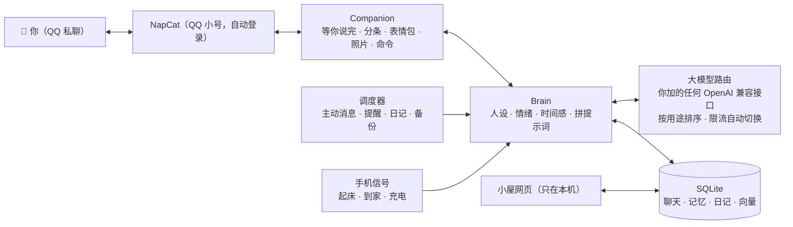

# 有希（`python run.py yuki`）

这是 ai-life 里“QQ 私聊”这个角色的说明：一对一陪你的 AI 伴侣，用一个 QQ 小号。代码在 `ailife/`，她的家在 `home/yuki/`（配置、密钥、数据、NapCat、自己写的人设）。
怎么装、怎么启动、放服务器，看[根目录的 README](../README.md)；配置项的完整说明在 `config.example.yaml`。

## 简介

ai-life 不是一个“问一句答一句”的聊天机器人。TA 有自己的一天：要上课或上班，晚上写日记，身边有固定的朋友，也有持续几周的经历和几个月的长期目标。TA 记得你说过的事，会在合适的时候主动找你，你很久不回会想你，你难过时会认真陪你。

- **数据在你自己手里**：程序和全部数据都在你自己的电脑（或你自己的服务器）上，只有发给大模型的那部分内容会经过对应的服务商。
- **大模型你自己选**：程序里不内置任何接口，填一个 OpenAI 兼容的地址和 Key 就能用（云上的大模型服务、本机 Ollama / LM Studio 都行）；很多服务商都有免费额度。不需要显卡；想让她一直在线，可以放在一台便宜的 Linux 服务器上。
- **角色完全由你决定**：自带几个人设，也可以回答几个问题自动生成、导入 SillyTavern 角色卡，或者用 Markdown 自己写。

## 功能

| | 功能 | 说明 |
| --- | --- | --- |
| 💬 | **像真人一样聊天** | 分几条发、有打字停顿（你那边显示“对方正在输入…”）、会引用你的话、发表情包，偶尔打错字再补一句“*正确的字”，说出口又后悔会撤回；你连发几条时等你说完再一起回 |
| 🧠 | **长期记忆** | 自动整理关于你的事，新信息更新旧信息、不重复记；关键词 + 语义向量混合检索；TA 自己说过的设定也会记住，前后一致 |
| 💗 | **情绪与时间感** | 心情会随聊天变化并慢慢平复；知道你几天没来、现在是深夜还是早上；好感度永远是满的 |
| 🌏 | **TA 自己的生活** | 每天的安排、每晚的日记、身边的人、持续几周的故事线、长期目标；按真实日期过学期、考试周、寒暑假或工作日 |
| 🔔 | **主动找你** | 早安晚安、想你了来找你、到点提醒你；会学习你的回复习惯，少打扰你；夜里免打扰 |
| 🌙 | **关机前后** | 关掉程序时 TA 说一声“先去忙了”；开机后说说这段时间在干嘛，错过的提醒和纪念日一起补上 |
| 📱 | **手机信号**（可选） | 手机快捷指令在起床、到家、充电时发个信号，她就知道你醒了、到家了、准备睡了 |
| 🏠 | **小屋** | 浏览器打开 `http://127.0.0.1:8765`，看 TA 的心情、日记、记忆、留言板，还能直接改人设；还有各个连接的状态（绿 / 蓝 / 黄 / 灰四色一眼看清）、换大模型、软件更新。只在本机能打开；放在服务器上时用 SSH 隧道在自己电脑上看 |
| 🎧 | **一起做的事** | 打卡、追番、听歌、愿望清单、时间胶囊、每月纪念册、睡前故事 |
| 🔗 | **看得懂你发的东西** | 图片、表情包（动图也行）、合并转发的聊天记录、分享卡片，B 站 / YouTube / 公众号 / 网页链接（先点开读完再回你）；视频、文件知道你发了什么 |
| 🐧 | **QQ** | 一键自动下载配置 NapCat，扫一次码以后自动登录；戳一戳、撤回、合并转发、分享卡片都认得，个性签名每天跟着她的心情变 |
| 👥 | **群聊角色**（同一个仓库） | 想要一个待在 QQ 群、微信群里的角色：`python run.py qq` / `python run.py wechat`（另一个小号、另一个人设，可以和这里同时开），见 [GROUP_QQ.md](GROUP_QQ.md)、[GROUP_WECHAT.md](GROUP_WECHAT.md) |

每个功能的详细说明见 **[docs/FEATURES.md](FEATURES.md)**。

## 工作原理



---

## 配置详解

所有设置都在 `config.yaml` 里，每一项都有中文注释。改完重启生效。常用部分：

| 配置段 | 作用 |
| --- | --- |
| `proxy` | 大模型接口需要代理时填，支持 `http://` 和 `socks5://`（每个模型可以单独选走不走代理） |
| `persona_file` | 当前使用的人设文件 |
| `llm.profiles` / `llm.routes` | 你加的大模型，以及每种用途按顺序用哪些（一般在小屋里加，写进 `config.llm.yaml`） |
| `style` | 打字速度、表情包频率、错字率 |
| `proactive` | 主动消息：频率、免打扰时段、早安晚安时间、连续未回复上限 |
| `away` | 关机前道别、开机后补上错过的事 |
| `qq` | QQ 私聊：NapCat 地址和 token、你的 QQ（`owner_id`）、你的称呼（`owner_name`）、NapCat 文件夹和自动启动（`qq_setup` 会写好） |
| `sense` | 手机信号（ntfy 频道） |
| `web` | 小屋网页（只监听本机，端口 8765） |
| `story` / `mind` / `her_world` | TA 的故事线、内心独白、身边的人和长期目标 |
| `backup` / `letter` / `links` | 备份、每周来信、读链接 |

### 人设

角色就是 `persona/` 里的一个 Markdown 文件：开头几行写名字、称呼、性别、年龄、身份、外貌，下面用自然语言写 TA 是谁、性格、说话方式，最后几段对话示例。

```bash
python run.py yuki persona new                   # 回答几个问题生成（可以让大模型帮忙扩写）
python run.py yuki persona import 角色卡.png      # 导入 SillyTavern / TavernAI 角色卡（.png / .json）
python run.py yuki persona use persona/xxx.md    # 切换角色（每个角色有自己的记忆）
python run.py yuki persona check persona/xxx.md  # 检查写法
```

自带：`linxi.md`（林汐，温柔的插画编辑）、`shenyan.md`（沈言，男友向）、`template.md`（带注释的模板）。完整写法见 **[docs/PERSONA.md](PERSONA.md)**。

### 大模型配置

**不用写配置。** 在电脑上打开小屋（`http://127.0.0.1:8765`）→ 设置 →“大模型”，或者双击 **`scripts\llm.bat yuki`**：
填接口地址和 Key → 自动测连通、列出这个接口的模型 → 选一个 → 试一下 → 勾上它干什么：

| 用途 | 说明 | 没配的时候 |
| --- | --- | --- |
| `chat` | 聊天、主动消息 | ★ 至少要有一个 |
| `helper` | 其它小活（打标签、做判断） | 用 `chat` 的 |
| `memory` | 整理记忆（要准，可以用强一点的） | 用 `helper`，再没有用 `chat` |
| `night` | 写日记、排日程、周日来信 | 同上 |
| `vision` | 看你发的图 | 不看图 |
| `image` | 画她的照片（`/images/generations`） | 不发照片 |
| `embed` | 记忆检索的向量（`/embeddings`） | 只用关键词检索 |

列模型时会按名字猜它是聊天、看图、画图还是向量模型，帮你勾好；推理模型回复是空的时候会自动试着关掉“思考”。
加的模型写在 `config.llm.yaml`（Key 在 `.env`），不动你的 `config.yaml`；小屋里加完点“重启生效”就能用上。

也可以在 `config.yaml` 里手写：

```yaml
llm:
  profiles:
    my_chat:                           # 名字随便起
      base_url: https://你的接口地址/v1
      api_key: "${MY_CHAT_KEY}"        # Key 写在 .env：MY_CHAT_KEY=sk-...
      model: 模型名
    my_backup:
      base_url: http://127.0.0.1:11434/v1
      api_key: none
      model: qwen3:8b
  routes:
    chat:   [my_chat, my_backup]       # 前一个限流 / 出错自动换下一个
    vision: [my_chat]
```

- 一个模型限流或出错会自动换下一个并冷却一会儿；全部失败时 TA 会先说一句“网卡了，等我一下”，然后自动重试。
- 聊天优先：后台整理记忆这类任务会等你聊完再做，免得抢免费额度。
- 换完模型跑 `python run.py yuki bench` 测速度，跑 `python run.py yuki eval` 看人设表现有没有变差。

---

## 日常使用

### QQ 私聊里的命令（也可以用中文：/日记 /记忆 /心情 /小屋 /打卡 /帮助）

| 命令 | 作用 |
| --- | --- |
| `/status` | TA 现在的心情和今天的安排 |
| `/memory` · `/forget 编号` | TA 记得的关于你的事 / 删掉一条 |
| `/diary` · `/letter` · `/recap` | 日记 / 每周来信 / 每月纪念册 |
| `/story` · `/goals` · `/people` · `/mind` | 最近经历的事 / 长期目标 / 身边的人 / 在想什么 |
| `/photo` | 让 TA 发张照片 |
| `/city` · `/schedule` | 告诉 TA 你在哪个城市 / 你的作息 |
| `/dates` · `/shows` · `/watched` · `/song` | 重要日子 / 一起追番 / 看完一集 / 推荐一首歌 |
| `/habit` · `/wish` · `/capsule` | 一起打卡 / 愿望清单 / 时间胶囊 |
| `/home` · `/note` | 小屋在哪、怎么打开 / 在留言板留言 |
| `/persona` | 查看 / 切换角色，改完人设后 `/persona reload` |
| `/quality` | 这一周 TA 的表现（重复、出戏、回复长度……） |
| `/diag` | 一键自检 |
| `/sense` | 手机信号的设置 |
| `/profile` | TA 心里的你 |

### 命令行

| 命令 | 作用 |
| --- | --- |
| `python run.py yuki` | 启动 |
| `python run.py yuki setup` | 配置向导 |
| `python run.py yuki llm` | 管理大模型：填地址和 Key → 测连通 → 选模型 → 试一下 → 选用途（`scripts\llm.bat yuki`） |
| `python run.py yuki qqsetup` | QQ 一键配置（没有 NapCat 就自动下载；`--manual` 只读现成配置） |
| `python run.py yuki persona …` | 人设管理（list / check / use / new / import） |
| `python run.py yuki selftest` | 离线自检 |
| `python run.py yuki console` | 不连 QQ，在命令行里和 TA 聊（调人设用） |
| `python run.py yuki eval [--quick] [--judge]` | 人设评测：重复率、出戏、长对话、记忆 |
| `python run.py yuki bench` | 测每个大模型接口的速度 |
| `python run.py yuki update [apply\|rollback]` | 检查 / 安装更新、换回上一个版本 |
| `python run.py yuki help` | 所有命令 |
| `python run.py yuki export` / `import 包.zip` | 备份 / 换电脑 |

---

## 常见问题

<details>
<summary><b>TA 不回消息</b></summary>

在 QQ 里发 `/diag`，或者看 `data/logs/ailife.log`。最常见的原因：NapCat 没连上、`qq.owner_id` 填的不是你自己的号、API Key 填错、免费模型限流（会自动换备用模型：在小屋“设置 → 大模型”里多加一个当备用）。

</details>

<details>
<summary><b>她回得乱七八糟 / 一句话回两遍</b></summary>

同一个 TA 同时在两个地方运行了（比如电脑和服务器都开着）。同一台电脑上托盘只会开一个；搬到服务器以后，电脑上别再启动。

</details>

<details>
<summary><b>pip 安装失败</b></summary>

先确认网络正常，再运行一次 `install.bat`（清华镜像失败时会自动换默认源）。

</details>

<details>
<summary><b>每次启动 NapCat 都要扫码</b></summary>

旧版本的启动参数写错了（NapCat 只认 `-q 号码`），更新到最新代码就好。确认 `config.yaml` 的 `qq:` 里有 `napcat_qq: 她的小号`（`scripts\qq_setup.bat` 会写）。如果小号在手机上被踢下线、改了密码，或者很久没登录，QQ 会要求重新扫码，这时二维码会自动弹出来，扫一次就行。

</details>

<details>
<summary><b>NapCat 下载失败</b></summary>

会依次试 GitHub 直连和几个公共加速地址。都不行的话，手动打开 [NapCat 发布页](https://github.com/NapNeko/NapCatQQ/releases) 下载 `NapCat.Shell.Windows.Node.zip`，放进项目文件夹，再双击 `scripts\qq_setup.bat`（会直接用这个 zip）。

</details>

<details>
<summary><b>放在服务器上，小屋打不开</b></summary>

小屋只监听服务器的 `127.0.0.1`，直接用服务器的公网地址是打不开的（这是故意的）。在自己电脑上开 SSH 隧道：`ssh -N -L 8765:127.0.0.1:8765 ubuntu@你的服务器地址`，窗口别关，再打开 `http://127.0.0.1:8765`。

</details>

<details>
<summary><b>想换角色但不想丢记忆</b></summary>

每个角色的记忆分开保存，换回来都还在。想让新角色继承现在的记忆：`python run.py yuki persona use 文件 --share`。

</details>

---

## 隐私与安全

- 数据都在你自己的设备上：`data/`（聊天、记忆、照片）、`config.yaml`（设置）、`.env`（密钥），三者都在 `.gitignore` 里，不会被提交。
- 日志里如果出现密钥，会自动打码。
- 小屋网页只监听本机，拒绝跨站调用；放在服务器上时只能通过 SSH 隧道看，不对公网开放端口。NapCat 的端口也只绑在本机。
- 读链接时只访问公网地址，不会被一个链接引去访问你的路由器或局域网设备。
- 只认 `qq.owner_id` 这一个号的私聊，其他人发消息、群消息都不理。

## 内容准则

角色都是成年人，内容保持健康：不写露骨内容，不用冷战、威胁或让人愧疚的方式绑住你。你说起伤害自己的念头时，TA 会认真对待，并鼓励你找身边的人或专业帮助。AI 伴侣不能代替现实中的人际关系和专业支持。
